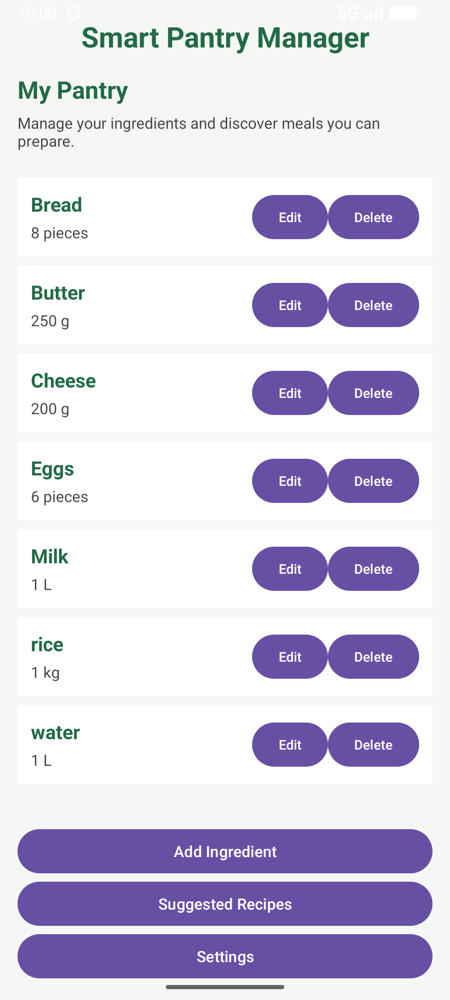
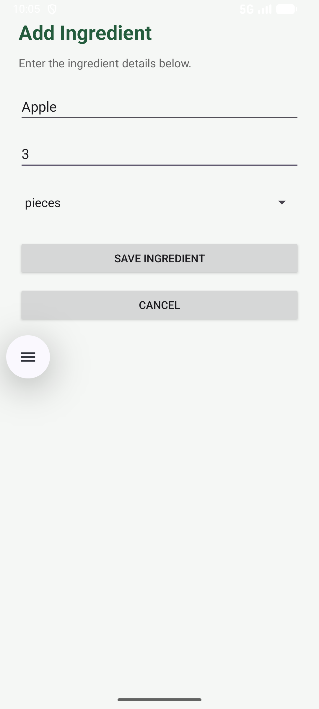
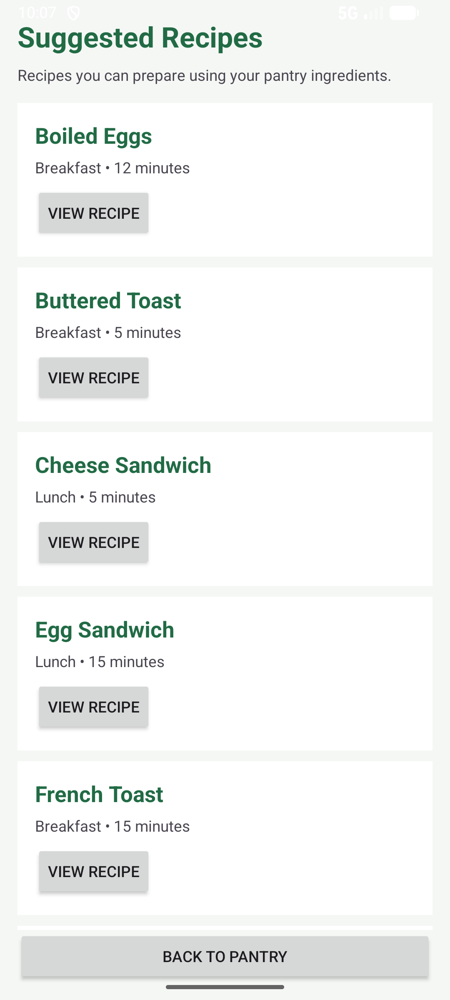
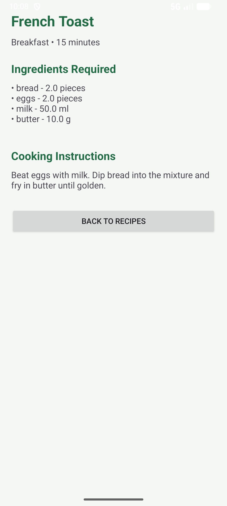
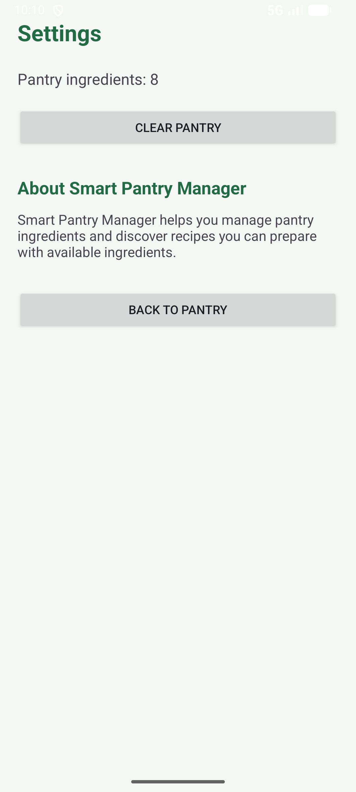

# Smart Pantry Manager

**Smart Pantry Manager** is an Android application developed using Java and SQLite. It helps users manage ingredients in their pantry and discover recipes they can prepare using the food they already have.

## 1. Project Objectives

The objectives of Smart Pantry Manager are to:

- Provide an easy way to manage pantry ingredients.
- Allow users to add, view, update and delete ingredients.
- Store ingredient information locally using SQLite.
- Recommend recipes based on available ingredients.
- Ensure recipes are suggested only when all required ingredients are available in sufficient quantities.
- Provide a simple and user-friendly Android interface.

## 2. Features

### Pantry Management

- Add new ingredients with names, quantities and measurement units.
- View saved ingredients in a RecyclerView.
- Edit existing ingredient details.
- Delete ingredients with a confirmation dialog.
- Display quantities in a readable format.
- Show an informative message when the pantry is empty.

### Recipe Suggestions

- Includes 20 predefined recipes.
- Suggests recipes based on ingredients available in the pantry.
- Checks ingredient quantities before recommending recipes.
- Supports basic singular and plural ingredient matching.
- Converts compatible measurement units, including kg to g and L to ml.
- Combines quantities from multiple pantry entries where appropriate.

### Recipe Details

Users can view:

- Recipe name
- Recipe category
- Preparation time
- Required ingredients and quantities
- Cooking instructions

### Settings

- View the total number of pantry ingredients.
- Clear all pantry ingredients.
- Display a confirmation dialog before clearing the pantry.

## 3. Technologies Used

| Technology | Purpose |
|---|---|
| Java | Application development |
| Android Studio | Development environment |
| Android SDK | Android application framework |
| SQLite | Local database storage |
| RecyclerView | Display pantry ingredients and recipes |
| XML | User interface layouts |
| Git | Version control |
| GitHub | Source code repository |

## 4. Application Screens

The application contains five main screens.

**1. Pantry List**

Displays all saved pantry ingredients and provides access to ingredient management, suggested recipes and settings.

**2. Add/Edit Ingredient**

Allows users to enter or update ingredient names, quantities and measurement units. Input validation prevents empty names and invalid quantities.

**3. Suggested Recipes**

Displays recipes that can be prepared using the ingredients currently available in the pantry.

**4. Recipe Detail**

Displays a selected recipe's ingredients, preparation time, category and cooking instructions.

**5. Settings**

Displays the pantry ingredient count and provides an option to clear the pantry.

## 5. Application Screenshots

### Pantry List

### Add Ingredient

### Suggested Recipes

### Recipe Detail

### Settings

## 6. Database Design

The application uses SQLite to store pantry and recipe information locally.

### Ingredients Table

Stores ingredients added by the user.

Fields include:

- `id` — Unique ingredient identifier
- `name` — Ingredient name
- `quantity` — Available quantity
- `unit` — Measurement unit

### Recipes Table

Stores the 20 predefined recipes.

Fields include:

- `id` — Unique recipe identifier
- `name` — Recipe name
- `instructions` — Cooking instructions
- `preparation_time` — Estimated preparation time
- `category` — Recipe category

### Recipe Ingredients Table

Stores the ingredients required for each recipe.

Fields include:

- `id` — Unique record identifier
- `recipe_id` — Reference to the recipe
- `ingredient_name` — Required ingredient name
- `quantity` — Required quantity
- `unit` — Required measurement unit

The `recipe_ingredients` table links required ingredients to their corresponding recipes.

## 7. Recipe Matching Algorithm

Smart Pantry Manager uses a strict recipe matching algorithm.

A recipe is suggested only when every required ingredient is available in sufficient quantity.

**Example**

Available pantry ingredients:

- Rice: 1 kg
- Water: 1 L

Recipe: **Plain Rice**

Required ingredients:

- Rice: 200 g
- Water: 400 ml

The application converts compatible units and determines that the pantry contains sufficient ingredients.

**Result:** Plain Rice is suggested.

If Rice is reduced to 100 g, Plain Rice is no longer suggested because the available quantity is insufficient.

The matching algorithm also supports basic ingredient name normalization and aggregation of compatible quantities.

## 8. Installation Instructions

1. Install Android Studio.
2. Clone or download the project repository.
3. Open the SmartPantryManager folder in Android Studio.
4. Allow Gradle to synchronize.
5. Select an Android emulator or compatible physical Android device.
6. Build and run the application.

### GitHub Repository

https://github.com/BanKanku/SmartPantryManager

### Clone Command

`git clone https://github.com/BanKanku/SmartPantryManager.git`

## 9. Testing

The application has been manually tested for the following functionality:

- Adding pantry ingredients.
- Editing existing ingredients.
- Deleting ingredients.
- Saving and retrieving ingredients from SQLite.
- Validating ingredient quantities.
- Navigating between application screens.
- Displaying suggested recipes.
- Matching ingredients using compatible measurement units.
- Excluding recipes when ingredient quantities are insufficient.
- Displaying recipe details.
- Clearing pantry ingredients with confirmation.

## 10. Challenges and Solutions

**Challenge 1: Persistent ingredient storage**

The application required ingredient data to remain available after navigating between screens or restarting the application.

**Solution:** SQLite was implemented to store pantry information locally.

**Challenge 2: Accurate recipe suggestions**

Recipes should not appear when the user has insufficient ingredients.

**Solution:** A recipe matching algorithm was implemented to check every required ingredient and its quantity.

**Challenge 3: Different measurement units**

Pantry quantities and recipe requirements may use different units.

**Solution:** The matching engine normalizes compatible units before comparing quantities.

**Challenge 4: Keeping the interface updated**

The ingredient list needed to reflect additions, edits and deletions.

**Solution:** RecyclerView and its adapter were used to refresh the displayed ingredient information.

## 11. Future Improvements

Possible future enhancements include:

- Ingredient expiry-date tracking.
- Low-stock notifications.
- Shopping list generation.
- Recipe searching and filtering.
- User-created recipes.
- Cloud synchronization.
- Barcode scanning.

These features are proposed for future development and are not included in the current version.

## 12. Conclusion

Smart Pantry Manager demonstrates the integration of Java, Android UI components, SQLite database operations and ingredient-based recipe recommendations.

The application provides a practical way to organize pantry ingredients and identify meals that can be prepared using available food.

---

**Project:** Smart Pantry Manager  
**Platform:** Android  
**Programming Language:** Java  
**Database:** SQLite  
**Development Environment:** Android Studio  
**Version Control:** Git and GitHub  
**Institution:** Richfield  
**Module:** Mobile App Development 700
